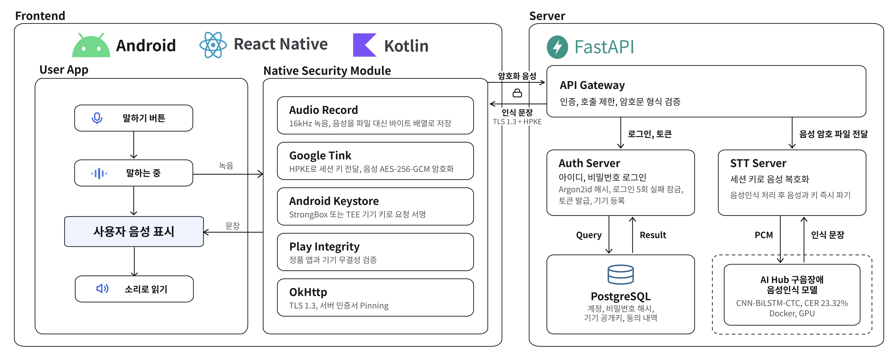

<div align="center">

<h1>🗣️ 이음새</h1>
<h3>구음장애인을 위한 새로운 대화 창구</h3>

<p>이음새는 구음장애인이 목소리를 포기하지 않고도 자연스럽게 소통할 수 있도록 도와주는 서비스입니다.</p>

<p>
  
  
  
  
  
  
</p>

<p>
  <a href="#features">주요 기능</a> ,
  <a href="#architecture">시스템 구조</a> ,
  <a href="#security">보안 설계</a> ,
  <a href="#quick-start">실행 방법</a>
</p>

</div>

---

## 📖 프로젝트 소개

**이음새는 구음장애인의 발화를 텍스트로 변환해 대면 의사소통을 돕는 서비스입니다.** 구음장애인이 말을 하면 이를 실시간으로 문자로 변환해 화면의 띄워줍니다. 변환든 문자를 읽어주는 TTS 기능도 제공하고 있습니다.

이름새를 통해 구음장애인은 본인의 목소리 사용을 포기하지 않고도 상대방과 의사소틍을 수행할 수 있습니다. 병원, 복지시설, 공공기관처럼 낯선 상대에게 의사를 전달해야 하는 상황에서 사용될 수 있으며, 휴대전화 뿐 아니라 기관에 설치된 테블릿, 키오스크 등으로도 확장될 수 있습니다.


> **본 서비스에서 제공하는 기능은 대표적으로 다음과 같습니다.**
>
> 사용자 친화적 UI(큰버튼&큰글씨, 간단한 화면), 앱 화면 180도 전환, 이어 말하기 기능

## 🧭 목차

1. [주요 기능](#features)
2. [음성 처리 흐름](#voice-flow)
3. [시스템 구조](#architecture)
4. [보안 설계](#security)
5. [실행 방법](#quick-start)
6. [테스트](#testing)
7. [저장소 구성](#structure)
8. [프로젝트 자료](#documents)
9. [개발 역할](#team)

---

<a id="features"></a>

## ✨ 주요 기능

| 기능 | 설명                                                         |
| --- |------------------------------------------------------------|
| 🎙️ **구음장애 음성인식** | AI Hub의 구음장애 음성인식 데이터를 학습한 모델을 활용해 음성을 글자로 변환합니다.          |
| 💬 **대면 대화 화면** | 음성인식 결과를 큰 글씨로 보여 줍니다.                                     |
| 🔄 **상대방 방향 전환** | 화면을 180도 돌려 맞은편 사람이 문장을 확인할 수 있게 합니다.                      |
| ➕ **이어 말하기** | 새 녹음을 시작해 대화를 이어 갑니다.                                      |
| 🔊 **감정 음성 TTS** | 사용자가 선택한 감정-보통,기쁨,슬픔,화남-에 맞춰 인식된 문장을 읽습니다.                              |
| 🤝 **대화 배려 안내** | 사용자가 선택한 이해 수준에 따라 “천천히 말해 주세요” 등의 문구를 표시합니다.              |
| 👤 **계정,동의 관리** | 이메일 인증 가입, 로그인, 계정 찾기, 비밀번호 재설정,변경, 동의 관리, 로그아웃,탈퇴를 지원합니다. |

소통 정보의 수집 동의 및 화면에 지적 수준 표시 여부는 사용자가 선택할 수 있습니다.

---

<a id="voice-flow"></a>

## 🎧 음성 처리 흐름

- **전송:** 녹음 중 약 1초마다 음성 조각을 암호화해 서버로 보냅니다.
- **인식:** ‘다 말했어요’를 누르고 마지막 데이터까지 도착하면 전체 음성을 합쳐 한 번에 처리합니다.
- **정리:** 처리 완료,취소,만료 시 세션과 관리 가능한 음성 버퍼,키를 정리합니다.

| 항목 | 현재 기준                                     |
| --- |-------------------------------------------|
| 음성 조각 | 조각당 최대 1초                                 |
| 한 번의 녹음 | 최대 30조각, 최대 30초                           |
| STT 실행 위치 | 로컬 서버 / CUDA 사용 가능 시 GPU, 아니면 CPU         |

### TTS 처리 방식

**감정 음성은 별도 동의 후 ElevenLabs 클라우드에서 생성합니다.** 앱의 요청을 우리 서버가 받아 ElevenLabs에 전달하고, 생성된 음성을 암호화해 앱으로 돌려줍니다.

사용자가 개인정보 국외 의전을 동의하지 않았거나 일반적인 외부 호출 오류가 발생하면 기기의 기본 TTS 엔진을 사용합니다. 

---

<a id="architecture"></a>

## 🏗️ 시스템 구조


### 음성인식 모델

현재 실행 코드는 `SpeechTransformer`이며, **VGG-like CNN 특징 추출기와 Transformer 인코더,디코더**로 구성됩니다. 
<br>
인코더 12층,디코더 6층, 80차원 로그 멜 필터뱅크 특징, Greedy decoding을 사용합니다.


---

<a id="security"></a>

## 🔐 보안 설계

음성,인식 문장은 서버에 저장되지 않으며, 작업 종료 시 즉시 삭제됩니다. 사용자 계정, 기기 , 개인정보 동의 내역은 암호화되어 안전하게 저장됩니다.

| 보호 영역 | 적용 내용 |
| --- | --- |
| **비밀번호** | Argon2id 해시, 해시 생성마다 무작위 16바이트 Salt 적용 |
| **로그인** | 기본 연속 5회 실패 시 15분 잠금, 더미 해시 검증으로 응답 시간 차이에 따른 계정 종류 유추 방지 |
| **세션 토큰** | 단기 액세스 토큰, 리프레시 토큰 HMAC 저장 |
| **기기 신뢰** | 등록 시 Key Attestation 인증서 체인과 Play Integrity 판정 검증 |
| **요청 검증** | 기기 서명, Nonce, Timestamp와 세션 소유권 검증 |
| **통신** | TLS 1.3, OkHttp 공개키 지문 고정 |
| **음성,결과** | HPKE로 세션 키 전달, AES-256-GCM 인증 암호화 |
| **저장 소통 정보** | AES-256-GCM과 사용자 ID 기반 AAD로 사용자 간 암호문 치환 방어 |
| **장기 비밀정보** | Windows DPAPI 암호화 보관, 표준입력 전달, 읽기 권한만 부여 |
| **모델,오류 처리** | 모델 SHA-256 검사, 입력,자원 제한, 고정 오류 코드와 민감 원문 로그 차단 |


---

<a id="quick-start"></a>

## ⚡ 실행 방법

모든 명령은 별도 표시가 없으면 **저장소 루트의 Windows PowerShell**에서 실행합니다. 서버는 Windows + Docker Desktop 환경을 기준으로 서술되어 있습니다.

### 1. 준비물

| 항목 | 필요한 내용 |
| --- | --- |
| 서버 호스트 | Windows, Docker Desktop의 Linux 컨테이너 모드 |
| 호스트 Python | Python 3.12 권장, 준비 도구 실행에 필요한 의존성 |
| Android 개발 | Android Studio, JDK 17, SDK 36, 호환 Gradle 8.13 |
| 앱 실행 기기 | Android 10(API 29) 이상, 마이크 권한 |
| 모델 | 배포할 `.pt` 가중치와 신뢰할 수 있는 SHA-256 |
| 인증,외부 연동 | TLS 인증서, SMTP, Google Play Integrity 설정,서비스 계정, ElevenLabs 설정 |

호스트 Python 환경을 처음 구성하는 경우:

```powershell
python -m venv .venv
.\.venv\Scripts\Activate.ps1
python -m pip install --require-hashes -r server/auth/requirements.lock
```

이 과정은 호스트 준비 도구의 Python 환경을 구성합니다. 인증,STT 서버의 실행 의존성은 시작 과정에서 각 Docker 이미지로 설치됩니다. 모델 변환 도구를 호스트에서 실행하려면 별도로 호환 PyTorch 환경이 필요합니다.

### 2. 서버 설정

[`server/.env.example`](server/.env.example)을 참고해 SMTP,앱 서명 인증서 지문,외부 TTS 모델 및 음성 ID,서버 서명키 ID와 만료 시각,모델 SHA-256,인증 상태 조회 HTTPS 주소,신뢰 프록시를 설정합니다.

가중치는 `server/stt/models/ieumsae_stt.pt`에 준비합니다. 비밀번호,개인키,서비스 계정 JSON,API 키는 `.env`에 넣지 않고 [비밀정보 운영 안내](server/SECRETS.md)의 DPAPI 보관 절차로 공급합니다. 기존 환경은 키를 재생성하지 않고 값을 유지해 이전합니다.

### 3. 시작

```powershell
python server/tools/deployment_check.py
python server/start.py --check
```

검사 결과와 종료 코드를 확인한 뒤 서버를 시작합니다.

```powershell
python server/start.py
```

NVIDIA GPU를 연결할 때는 위 시작 명령 대신 다음을 사용합니다.

```powershell
python server/start.py --gpu
```

`docker compose up`만으로는 DPAPI 보관함의 비밀정보가 공급되지 않으므로 시작 도구를 사용합니다. `SERVER_START_REQUESTED`는 시작 요청 성공이며, 실제 서비스 준비 상태는 `/auth/health`, `/system/health`와 기능 점검으로 확인합니다.

### 4. Android 앱 빌드

[`server-keys.properties.example`](android/server-keys.properties.example)을 기준으로 `android/server-keys.properties`를 준비합니다. 이 파일에는 서버 서명키 ID, 서명 공개키, TLS 공개키 지문을 설정합니다.

```powershell
$env:IEUMSAE_API_BASE_URL = "https://api.example.invalid/"
$env:IEUMSAE_CLOUD_PROJECT_NUMBER = "123456789012"
gradle -p android :app:assembleDebug
```

도메인과 프로젝트 번호는 실제 값으로 바꿉니다. 환경변수 대신 Gradle 속성도 사용할 수 있습니다. [`build-settings.env.example`](android/build-settings.env.example)은 설정 이름을 보여 주는 예제이며 자동으로 읽히는 파일은 아닙니다.

현재 저장소에는 Gradle Wrapper가 없어 호환 Gradle을 설치하거나 Android Studio의 Gradle 설정을 사용해야 합니다. 기기 등록 성공에는 Play Console,앱 서명,배포 설정도 필요합니다. APK 빌드 성공만으로 Play Integrity 검증이 성공하는 것은 아닙니다.

---

<a id="testing"></a>

## 🧪 테스트

| 범위 | 테스트 내용 | 위치 |
| --- | --- | --- |
| 인증,기기 | 가입, 비밀번호, 기기 폐기, 증명, 세션 | [security_test.py](server/tests/security_test.py) |
| 보안약점 개선 | DPAPI 이전,비밀정보 공급,예외 경계,모델 내보내기 | [remediation_test.py](server/tests/remediation_test.py) |
| 입력,오류 경계 | 크기,시간,로그,오류 정보,세션 한계 | [boundary_test.py](server/tests/boundary_test.py) |
| 서버 시작 | 모델 검사,GPU 옵션,로더 순서 | [start_test.py](server/tests/start_test.py) |
| 모델,TTS | 디코딩 동작,외부 응답 검증 | [asr_test.py](server/tests/asr_test.py), [tts_test.py](server/tests/tts_test.py) |
| Android | 가입 규칙,로그아웃 실패,민감 버퍼,재생 정리 | [앱 단위 테스트](android/app/src/test/) |

필요한 테스트 의존성과 모델을 준비한 환경에서 실행합니다.

```powershell
python -m unittest discover -s server/tests -p "*_test.py" -v
gradle -p android :app:testDebugUnitTest
```

모델 통합 테스트에는 실제 체크포인트와 PyTorch,torchaudio가 필요하며, DPAPI 테스트는 Windows가 필요합니다. 테스트 코드의 존재와 실행 통과는 구분하고, 결과는 커밋,환경,명령과 함께 기록합니다. 실기기 마이크,재생,화면 이동과 Sparrow 재진단도 별도 확인 대상입니다.

---

<a id="structure"></a>

## 🗂️ 저장소 구성

```text
Ieumsae/
├── android/                     # Kotlin,Jetpack Compose 앱
│   └── app/src/
│       ├── main/                # 화면,녹음,인증,암호화,TTS
│       └── test/                # JVM 단위 테스트
├── server/
│   ├── auth/                    # 계정,기기,동의,DB
│   ├── stt/                     # 음성인식 모델,STT,TTS API
│   ├── gateway/                 # Nginx TLS,프록시,요청 제한
│   ├── shared/                  # 토큰,서명,입력,로그 공통 처리
│   ├── tools/                   # 키 생성,비밀정보 이전,배포 검사
│   ├── tests/                   # 기능,보안,회귀 테스트
│   ├── sbom/                    # 의존성 구성 자료
│   ├── docker-compose.yml       # 기본 서비스 구성
│   ├── docker-compose.gpu.yml   # NVIDIA GPU 추가 구성
│   └── start.py                 # 검사,비밀정보 공급,서버 시작
├── document/                    # 프로젝트 문서
└── README.md
```

---

<a id="team"></a>

## 👥 개발 역할

| 담당                                                          | 주요 역할 |GitHub|
|-------------------------------------------------------------| --- | --- |
| **배준영ㅣ앱,서버 개발** | Android,API 개발, 모델 연동, 보안 기능과 취약점 개선, 통합 검증 | [@chunbae74](https://github.com/chunbae74) |
| **송민경ㅣ기획,UX/UI**                                          | 서비스,앱 화면 흐름 기획, 사용성 의견 정리, 발표자료, 보고서 작성 | [@123k4](https://github.com/123k4)

<div align="center">
<br>
<strong>이음새 — 구음장애인을 위한 새로운 대화 창구</strong>
<br><br>
</div>
