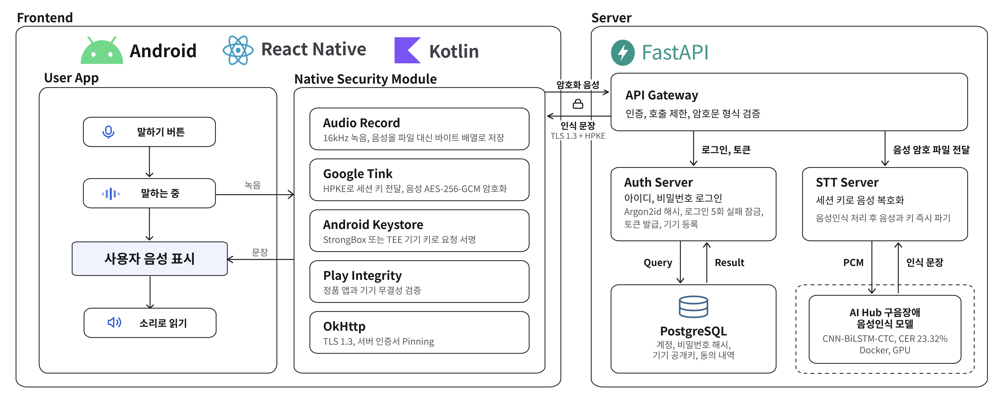
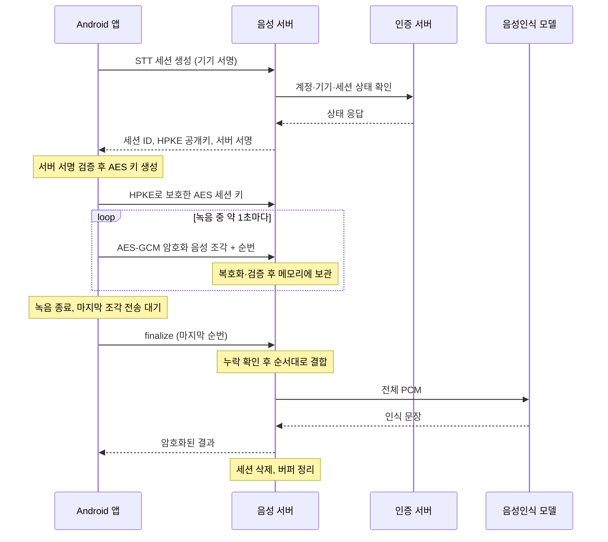

# 시스템 구조

## 전체 구성

- **Nginx 게이트웨이**: 외부 HTTPS 요청을 수신하고 요청 크기와 빈도를 제한합니다.
- **인증 서버**: 계정, 기기, 로그인 세션, 동의, 소통 정보를 관리합니다.
- **음성 서버**: STT/TTS 세션을 처리합니다.
- **PostgreSQL**: 암호화된 계정 및 설정 정보를 저장합니다. 녹음 내용은 저장하지 않습니다.

호스트에 공개된 포트는 게이트웨이의 443 포트뿐이며, 인증,음성 API와 DB 포트는 외부에 공개하지 않습니다. 게이트웨이와 각 API 사이 구간은 컨테이너 내부 HTTP로 통신하지만, 음성 데이터는 앱 계층에서 별도로 암호화되어 있으므로 음성 서버에서만 복호화됩니다.

## 음성인식 처리 흐름

그림에는 세션 생성 시점의 상태 조회만 표시하였으나, 실제로는 모든 STT API 요청에서 기기 서명과 인증 상태를 검증합니다.

`/finalize` 요청 시 전체 음성을 결합한 후 `transcribe_pcm16()`을 한 번 호출하여 음성인식을 수행합니다. 누락된 음성 데이터 조각이 있으면 `409 missing_chunks`를 반환합니다.

## 감정 TTS 처리 흐름

1. 앱이 개인정보 해외 이전 동의 여부를 확인한 후 TTS 세션을 요청합니다.
2. 서버가 인증 서버에 현재 동의 상태를 재확인합니다.
3. 앱이 출력할 문장, 감정, 응답용 AES 키를 HPKE로 보호하여 전송합니다.
4. 서버가 복호화한 문장을 HTTPS로 ElevenLabs에 전달합니다.
5. 생성된 음성을 응답용 키로 암호화하여 앱에 반환하고, 앱에서 재생합니다.

ElevenLabs에는 출력할 문장만 전송되며 STT 녹음 데이터는 전송되지 않습니다. 동의하지 않은 사용자는 기기 기본 TTS를 사용합니다.

## 데이터 보관

| 데이터 | 위치 | 보관 및 정리 방식             |
| --- | --- |------------------------|
| 녹음 조각 | 앱, 음성 서버 메모리 | 완료,취소,만료 시 버퍼 정리       |
| 음성 세션 키 | 앱, 음성 서버 메모리 | 세션마다 새로 생성, 정리 시 덮어쓰기  |
| 인식 문장 | 서버 메모리, 앱 화면 | 서버에 아무것도 저장되지 않음       |
| 감정 TTS 문장 및 음성 | 앱·서버 메모리, ElevenLabs | 동의 확인 후에만 전송           |
| 계정, 기기, 동의 이력 | PostgreSQL | 철회,탈퇴 시 각 기능의 삭제 로직 적용 |
| 비밀번호 | PostgreSQL `users.password_hash` | Argon2id 해시로 저장        |
| 서버 비밀정보 | Windows DPAPI 보관함 | 서버 시작 시 서비스별 tmpfs로 전달 |

## 세션 및 키 구분

| 이름 | 용도 | 코드 |
| --- | --- | --- |
| 로그인 세션 | 로그인 유지, 토큰 갱신 및 폐기 | [auth/sessions.py](../server/auth/ieumsae_auth/sessions.py) |
| STT 세션 | 1회 녹음의 조각, 키, 만료 관리 | [stt/sessions.py](../server/stt/ieumsae_stt/sessions.py) |
| TTS 세션 | 1회 감정 합성 요청 | [main.py](../server/stt/ieumsae_stt/main.py) |
| TLS 연결 | 앱과 게이트웨이 간 전송 보호 | [Api.kt](../android/app/src/main/java/kr/ieumsae/app/data/Api.kt) |
| DB 세션 | DB 트랜잭션 처리 | [db.py](../server/auth/ieumsae_auth/db.py) |

소통 정보 암호화 키는 서버 전체에서 하나의 키를 사용하며, 음성 암호화 키는 녹음마다 새로 생성합니다. 사용자 ID는 소통 정보 암호화의 AAD로 사용되며 암호화 키가 아닙니다.